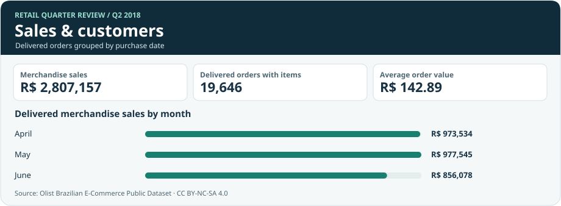
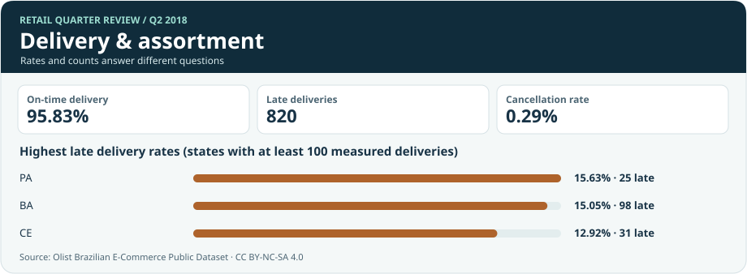

# Retail Quarter Review: Sales rose. Did demand?

## Introduction

I wanted to know what was behind a stronger sales quarter at an online retailer. In Q2 2018, Olist sold **R$2.81 million** in delivered merchandise, up **3.80%** from Q1. But it delivered **981 fewer orders**. I looked at what shoppers spent, how much the largest orders mattered, and whether the retailer kept its delivery promises.

[Power BI report](power-bi/) · [SQL walkthrough](docs/SQL_WALKTHROUGH.md)

## Background

### I started with the order, not the item

I used five tables from the [Olist Brazilian E-Commerce Public Dataset](https://www.kaggle.com/datasets/olistbr/brazilian-ecommerce): orders, customers, items, products, and category translations. The source contains **99,441 orders** and **112,650 item rows**. I compared orders purchased in **Q2 2018** with **Q1 2018** and used **Q2 2017** as a same-quarter benchmark.

I added up the items on each order before building the scorecard. Otherwise, a basket with five items would count as five orders. I kept a separate item view for category analysis. I also checked for duplicate keys, kept orders without items in the placed-order count, and set aside delivery records with missing or inconsistent dates only when calculating on-time delivery. The [audit](results/audit.json) records the exceptions.

### The Questions Answered:

1. Why did sales rise even though fewer orders were delivered?
2. Did sales still grow without the largest baskets?
3. How did delivery performance change, and where would I investigate?
4. Which categories contributed most to the change in sales?

## Tools

- **SQL and SQLite:** I built separate order and item views and wrote eight queries.
- **Python:** I loaded and checked five source tables.
- **Power BI and DAX:** I built two editable report pages and measures for the retail KPIs.

## Analysis

### What I measured

| KPI | Q1 2018 | Q2 2018 | How I counted it |
|---|---:|---:|---|
| Delivered merchandise sales | R$2,704,438.38 | **R$2,807,156.64** | Item value on delivered orders, excluding freight |
| Delivered orders with items | 20,627 | **19,646** | One count per eligible order |
| Average order value (AOV) | R$131.11 | **R$142.89** | Merchandise sales ÷ delivered orders with items |
| Items per order | 1.14 | **1.15** | Item rows ÷ delivered orders with items |
| On-time delivery rate | 87.12% | **95.83%** | Arrived by the promised date ÷ delivered orders with usable dates |
| Cancellation rate | 0.63% | **0.29%** | Canceled orders ÷ all placed orders |
| Repeat buyer rate | 1.98% | **1.26%** | Buyers who placed at least two eligible orders ÷ buyers with at least one in the quarter |

### Findings

#### 1. Higher order values made up for fewer orders

I broke the R$102,718 increase into two parts. At Q1's average order value, delivering 981 fewer orders would have cost about **R$128,620** in sales. The higher Q2 average order value added about **R$231,339**, more than making up for the volume drop. Sales were also **124.23% higher** than in Q2 2017, when Olist delivered far fewer orders. That longer comparison answers a different question from the change since Q1.

#### 2. The increase depended on large baskets

I calculated one cutoff for both quarters: **R$987**, the 99th percentile of pooled delivered order values. There were **231** orders above it in Q2 versus **162** in Q1. When I removed those orders from both quarters, merchandise sales **fell 1.54%** from Q1 to Q2. I kept them in the main scorecard because a large order can still be a real sale. The second calculation shows how sensitive the conclusion is to those orders.

#### 3. Delivery improved, but priorities depended on what I counted

The on-time rate improved by **8.71 percentage points**, from 87.12% to 95.83%. Among states with at least 100 measured deliveries, **Pará (PA)** had the highest late rate: **15.63%**, or 25 late deliveries out of 160. **São Paulo (SP)** had the most late deliveries: **207**. I would investigate Pará if the goal were to reduce the risk of a late order, and São Paulo if the goal were to reach more affected customers.

#### 4. The sales mix shifted

Watches and gifts gained **R$63,108** from Q1 and ranked first in Q2. Computer accessories lost **R$115,535**, the largest category decline. I would look at item prices and order mix in both categories before changing the assortment.

### How I showed it in the dashboard

I built two views in [Power BI](power-bi/): sales and customers, and delivery and assortment. Download and extract the repository ZIP, open `power-bi/RetailQuarter.pbip` in Power BI Desktop, and select **Refresh**. Choose one quarter to compare state delivery or repeat buying. The figures below are static previews built from the same SQL results.



**What I found in the sales view:** May was the strongest month in Q2, at about **R$977,545**. June sales were **12.43% lower** than May, even though Q2 as a whole beat Q1. The quarter and month views help separate those two signals.



**What I found in the delivery view:** A state can have a high late rate without producing the most late deliveries. I show both numbers so the choice of where to investigate is visible.

### Why I wrote the SQL this way

**I ranked categories after adding up their sales.** I used a CTE to make one row per category and quarter, then applied `DENSE_RANK`. If two categories tie for second, the next is still third.

```sql
WITH category_totals AS (
  SELECT period, category, SUM(price_cents) AS sales_cents
  FROM item_detail
  GROUP BY period, category
)
SELECT period, category, sales_cents,
       DENSE_RANK() OVER (
         PARTITION BY period ORDER BY sales_cents DESC
       ) AS sales_rank
FROM category_totals;
```

**I compared months only after grouping by month.** In the [monthly query](sql/02_monthly_trend.sql), I used `LAG` on the grouped rows. One row back is the prior month, and 12 rows back is the same month last year. I checked the calendar had no gaps before relying on those offsets.

```sql
SELECT month, sales_cents,
       LAG(sales_cents) OVER (ORDER BY month) AS previous_month,
       LAG(sales_cents, 12) OVER (ORDER BY month) AS same_month_last_year
FROM monthly;
```

The [SQL walkthrough](docs/SQL_WALKTHROUGH.md) explains all eight queries, including why I used `RANK` for the state comparison and `ROW_NUMBER` for the high-order cutoff. The [query results](results/) show the underlying counts and totals.

In Power BI, I use `DIVIDE([Merchandise sales], [Delivered orders])` for AOV. That way, both values respond to the same quarter filter. Averaging quarterly AOVs would give a quarter with fewer orders the same weight as one with more orders.

### What I would look at next

I would start by splitting high-value orders by category and buyer to see whether the Q2 increase came from a broad shift or a few unusually large purchases. For delivery, I would look at the largest sources of late orders and then compare seller, carrier, and route data if available.

I would use the repeat buyer rate as a prompt for a cohort analysis. This report measures second purchases inside the same quarter, so someone who first bought near the end of June had less time to return. I would give each buyer the same follow-up window before comparing retention.

The dataset does not show returns, refunds, or costs. I report delivered merchandise value and keep freight separate. I cannot use these numbers to calculate net revenue or profit.

To rebuild the SQL results, download the ZIP from [the data source](docs/SOURCE.md) and run `python scripts/build.py path/to/brazilian-ecommerce.zip` (Python 3.11+). The build checks that orders, items, and sales totals reconcile.

[KPI definitions and data checks](docs/METRICS.md)
